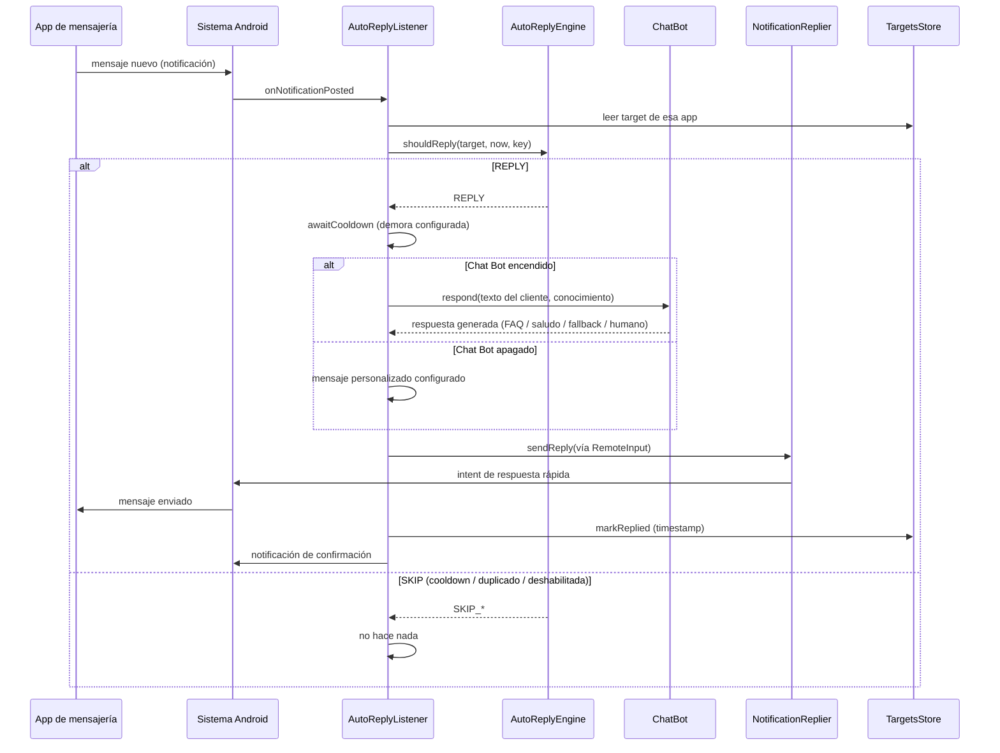

# DIAGRAM — DCA

## Arquitectura (VSA)

El código se organiza por capacidad vertical. Cada slice contiene su contrato,
su lógica pura, sus puntos de entrada y sus efectos externos; los tests viven
en el mismo paquete del slice bajo `app/src/test/`.

## MAPA DE SLICES

```
app/src/main/java/com/datecomp/dca/targets/        # Apps objetivo: contrato, lista, editor y persistencia | UI (lista/editor) | DataStore, PackageManager | deps: permissions
app/src/main/java/com/datecomp/dca/chatbot/        # Chat bot FAQ bilingüe y su conocimiento | mensaje del cliente, edición de conocimiento | DataStore | deps: none
app/src/main/java/com/datecomp/dca/autoreply/      # Decisión y envío de auto-respuestas | NotificationListenerService, BOOT_COMPLETED | DataStore, RemoteInput, notificaciones | deps: targets, chatbot
app/src/main/java/com/datecomp/dca/onboarding/     # Guía inicial y finalización | UI | DataStore | deps: permissions
app/src/main/java/com/datecomp/dca/permissions/    # Estado y solicitud de permisos del sistema | UI | Settings.Secure, PowerManager, rebind | deps: none
app/src/main/java/com/datecomp/dca/shell/          # Arranque, navegación y tema | MainActivity | ninguna | deps: targets, onboarding, permissions
app/src/main/java/com/datecomp/dca/LocalDataStore.kt # Instancia única de DataStore del proceso | — | DataStore | deps: none
```

## Flujo de auto-respuesta


